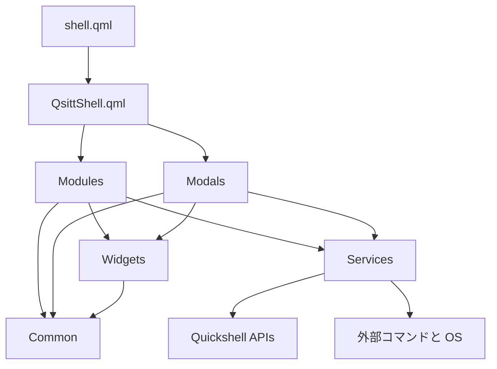
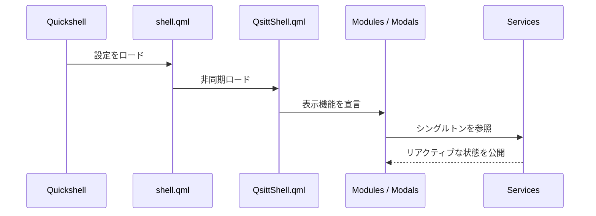
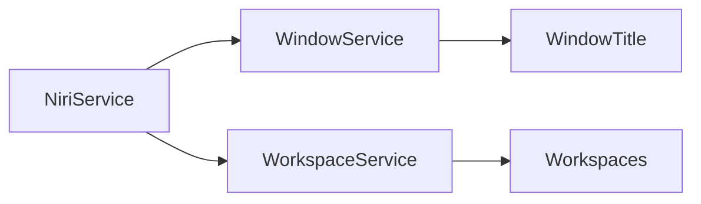
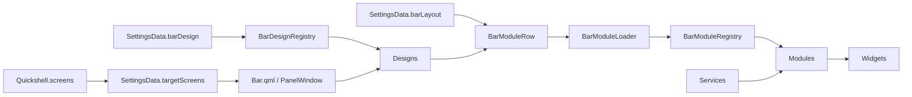

# qsitt アーキテクチャ

## 目的

qsitt は、システム状態の取得、画面への表示、再利用可能な UI、設定を分離した Quickshell アプリケーションである。設計上の主な目的は次のとおり。

- システム連携を UI から分離する
- 画面に表示される機能をモジュール単位で管理する
- テーマと設定を一元管理する
- モニターごとのサーフェス生成を共通化する
- バーの外観とモジュール配置を独立して変更できるようにする
- 常駐プロセスとして不要な処理や重複した状態を持たないようにする

## 全体構成

```text
qsitt/
├── shell.qml                 # Quickshell エントリーポイント
├── QsittShell.qml            # 表示機能の構成ルート
├── Common/                   # 設定、テーマ、アイコン、レジストリ
├── Services/                 # システム連携と共有状態
├── Modules/                  # 常設またはオーバーレイ表示される機能
│   ├── Bar/
│   ├── ControlCenter/
│   ├── Lock/
│   ├── Notifications/
│   └── QrScanner/
├── Modals/                   # 独立したモーダル UI
│   └── PowerMenu/
├── Widgets/                  # 機能に依存しない再利用 UI
└── docs/                     # 設計資料
```

依存関係は原則として上位の表示層から下位の共有層へ向かう。



`Common` のレジストリは例外的にモジュールの URL を返すが、モジュールを生成したり状態を保持したりはしない。

## 起動フロー

[`shell.qml`](../shell.qml) は `ShellRoot`、アプリケーション ID、ルートローダーだけを持つ。実際の UI は非同期 `Loader` から [`QsittShell.qml`](../QsittShell.qml) を読み込む。



`QsittShell.qml` は機能を組み合わせるだけで、システム状態や画面固有のレイアウトを保持しない。

## Common

`Common/` はアプリケーション全体で共有するシングルトンと静的リソースを管理する。

| ファイル | 責務 |
| --- | --- |
| `SettingsData.qml` | 対象モニター、バーのデザイン、バーのモジュール配置などの設定 |
| `Theme.qml` | 色、余白、角丸、フォントサイズ、バー寸法などのデザイントークン |
| `Icons.qml` | アイコンフォントのコードポイント |
| `Phosphor.ttf` | `QsIcon` が使用するアイコンフォント |
| `BarModuleRegistry.qml` | バーモジュール ID から QML URL への変換 |
| `BarDesignRegistry.qml` | バーデザイン ID から QML URL への変換 |

色や寸法を UI ファイルへ直接追加するのではなく、複数箇所で共有する値は `Theme` に定義する。実行時の状態やシステム情報は `Common` に置かない。

## Services

`Services/` の各 QML 型は `pragma Singleton` を持ち、アプリケーション内で状態を一つだけ保持する。UI は `import qs.Services` を通じてサービスを参照する。

| サービス | 責務 |
| --- | --- |
| `BluetoothService` | Bluetooth アダプター、デバイス、探索状態 |
| `BrightnessService` | バックライト値の取得と変更検知 |
| `ControlCenterService` | コントロールセンターと画面選択ツールの共有状態 |
| `CpuService` | CPU 負荷の定期取得 |
| `LockService` | PAM 認証とロック画面間の認証状態共有 |
| `MemoryService` | メモリ使用量の定期取得 |
| `NetworkService` | ネットワークデバイス、接続、Wi-Fi 状態 |
| `NiriService` | niri のイベントストリーム受信とイベント通知 |
| `NotificationService` | 通知サーバー、通知履歴、DND 状態 |
| `PowerService` | 電源メニューとセッションロックの状態 |
| `VolumeService` | PipeWire の入出力音量、ミュート、プロファイル |
| `WindowService` | フォーカス中のウィンドウタイトル |
| `WorkspaceService` | ワークスペース一覧、選択状態、緊急状態 |

### サービス間の依存

`NiriService` は compositor の生イベントを通知する低水準サービスである。`WindowService` と `WorkspaceService` はそのシグナルを購読し、UI が直接利用できる状態へ変換する。



サービスは表示要素を生成しない。状態変更は公開された関数を経由し、UI 側からサービス内部の `Process` や `Timer` を直接操作しない。

## Modules

`Modules/` は画面に表示される機能単位で分割されている。各モジュールは必要に応じて `PanelWindow`、`WlSessionLock`、ページ、機能固有の部品を所有する。

### Bar

`Modules/Bar/` はバーのウィンドウ生成、デザイン選択、配置、個別モジュールをまとめる。

```text
Bar/
├── Bar.qml                   # モニターごとの PanelWindow
├── BarContext.qml            # ホストウィンドウと対象画面
├── BarModuleRow.qml          # モジュール ID の行レイアウト
├── BarModuleLoader.qml       # ID に対応するモジュールの動的ロード
├── Designs/                  # バー全体の外観とセクション配置
├── Modules/                  # サービスと表示部品を接続するアダプター
└── Widgets/                  # バー専用の表示部品
```

バーの生成フローは次のとおり。



`BarContext` が渡すのは `hostWindow` と `targetScreen` だけである。システム状態は個別モジュールがサービスシングルトンから取得する。これにより、画面固有情報とアプリケーション全体の状態を混在させない。

`SettingsData.targetScreens` が空配列の場合は全モニターにバーを生成する。名前が指定されている場合は一致するモニターだけを対象にする。

### ControlCenter

`ControlCenter.qml` は対象モニターごとに全画面の透明サーフェスを生成し、その内部にコントロールセンター本体を配置する。表示状態は `ControlCenterService.visible` が管理する。

ページ固有の UI は同じディレクトリに置き、必要なサービスを明示的なプロパティとして受け取る。ページ選択など、その画面だけで完結する状態は `ControlCenter.qml` 内に保持する。

### Notifications

`NotificationService` が通知を受信して履歴へ保存し、`Notifications.qml` が一時ポップアップを表示する。`NotificationPopup.qml` はポップアップ表示と履歴表示の両方から利用される。

### QrScanner

`QrScanner.qml` は画面範囲の選択サーフェスと読み取りプロセスを所有する。コントロールセンターを閉じて範囲選択へ移るため、選択状態と結果メッセージは `ControlCenterService` を介して共有する。

### Lock

`Lock.qml` は `PowerService.locked` と `WlSessionLock.locked` を同期する。認証入力と PAM の状態は `LockService` に置き、複数モニターのロックサーフェスで共有する。

## Modals

`Modals/` は他の表示機能から開かれる独立した大きな UI を管理する。現在の `PowerMenu` は `PowerService.visible` を表示条件とし、電源操作用の外部プロセスをモーダル内部に所有する。

モーダルの開閉状態はサービスに置き、一時的な選択状態やアニメーション状態はモーダル内部に置く。

## Widgets

`Widgets/` は特定の画面やサービスへ依存しない再利用可能な UI コンポーネントを管理する。

- `QsIcon`: アイコンフォントの描画
- `QsIconLabel`: アイコンとテキストの組み合わせ
- `QsBarValue`: バー向けの値表示
- `QsCircularValue`: 円形の進捗表示
- `QsHighlightEffect`: 操作時のハイライト
- `QsPowerOption`: 電源メニューの選択項目

機能固有の部品はグローバルな `Widgets/` ではなく、対応するモジュールの配下へ置く。例えばバーだけで使う部品は `Modules/Bar/Widgets/` に属する。

## 状態管理

状態の配置は寿命と共有範囲で決める。

| 状態の種類 | 配置先 | 例 |
| --- | --- | --- |
| アプリケーション全体で共有する状態 | `Services/` | 音量、通知履歴、ロック状態 |
| 静的設定とデザイントークン | `Common/` | 対象モニター、色、余白 |
| 一つの表示機能だけで使う状態 | 対応する `Modules/` または `Modals/` | 選択中のページ、ホバー状態 |
| 派生表示値 | 利用するコンポーネントの `readonly property` | 接続表示名、選択状態 |

UI はサービスのプロパティへリアクティブにバインドする。状態を変更する処理が複数箇所から呼ばれる場合は、代入を分散させずサービスの関数にまとめる。

## 外部プロセス

OS コマンドとの連携には `Quickshell.Io.Process` を使用する。

- 継続的なイベント取得は一つの長寿命プロセスとしてサービスが所有する
- 定期取得は `Timer` と短寿命 `Process` の組み合わせにする
- ボタン操作に固有のコマンドは、その操作を所有するモジュールまたはモーダルに置く
- プロセスの標準出力はサービス側で UI 向けの型や状態へ変換する
- 異常終了後に再起動するプロセスは、即時ループを避けるため再試行間隔を設ける

## 命名規則

- QML ファイル、QML 型、ディレクトリは `PascalCase`
- ID、プロパティ、関数、設定キー、モジュール ID は `camelCase`
- サービス型は `Service` で終える
- グローバルな再利用 UI は `Qs` で始める
- 真偽値は状態が分かる名前にする。例: `visible`、`locked`、`qrBusy`
- 内部実装専用のプロパティは `_` で始める
- `shell.qml` だけは Quickshell のエントリーポイント規約に合わせて小文字とする

略語は外部 API や広く定着した用語を除いて避ける。例えばメモリ関連の型名には `Mem` ではなく `Memory` を使用する。

## 拡張方法

### バーモジュールを追加する

1. `Modules/Bar/Widgets/` に表示部品を追加する。
2. `Modules/Bar/Modules/` にサービスと表示部品を接続するアダプターを追加する。
3. `BarModuleRegistry.moduleNames` と `sourceFor()` にモジュール ID を登録する。
4. `SettingsData.barLayout` の `left`、`center`、`right` のいずれかへ ID を追加する。

未知のモジュール ID は警告を出して読み込みを省略する。

### バーデザインを追加する

1. `Modules/Bar/Designs/` に `moduleContext` を受け取る QML ファイルを追加する。
2. `BarDesignRegistry.barSourceFor()` にデザイン ID を登録する。
3. `SettingsData.barDesign` で ID を選択する。

未知のデザイン ID は標準デザインへフォールバックする。

### 新しい表示機能を追加する

1. `Modules/<FeatureName>/` または `Modals/<FeatureName>/` を作成する。
2. 共有状態やシステム連携が必要なら `Services/<FeatureName>Service.qml` を追加する。
3. 複数機能で再利用する UI だけを `Widgets/` に追加する。
4. `QsittShell.qml` からルートコンポーネントを生成する。

## 設計上の制約

- `shell.qml` に個別機能のロジックを追加しない
- サービスから UI 型を生成しない
- `Widgets/` から機能固有のモジュールを参照しない
- 同じシステム状態を複数コンポーネントで独立して取得しない
- 色や共有寸法を複数ファイルへハードコードしない
- `Variants` で生成された画面固有情報をグローバルサービスへ保存しない
- 常時実行する `Timer` や外部プロセスを必要以上に増やさない

## 検証

構造変更後は次を確認する。

1. `qs -p qsitt/` で設定が読み込めること
2. 実行ログに未解決の import、型、必須プロパティのエラーがないこと
3. `qmllint` で変更した QML を検査すること
4. `git diff --check` で空白エラーがないこと
5. 対象モニターごとのバー、オーバーレイ、モーダルを実表示で確認すること
6. バーモジュールの追加・削除・並べ替えが `SettingsData` の変更だけで反映されること
